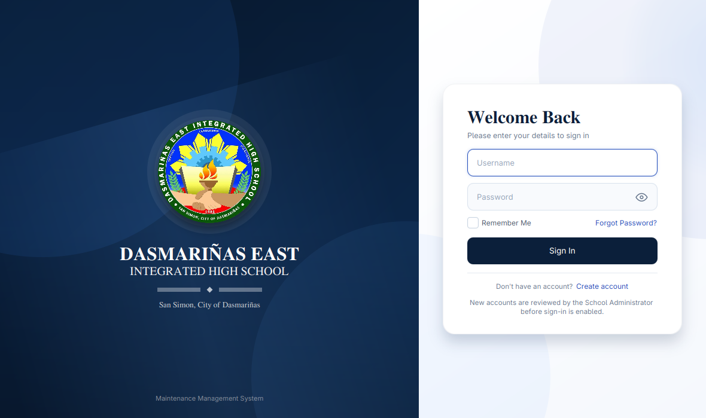

# DEIHS Maintenance Management System

A desktop maintenance-management system for **Dasmariñas East Integrated High School (DEIHS)**, built with **JavaFX 21** and **MySQL**, designed to run on a shared school LAN.

Teachers report facility and equipment problems, the maintenance head assigns work, personnel update progress, and administrators manage accounts and see reports — all against one central database.

> **Project status:** feature-complete for the initial defense. Google sign-in, LAN deployment, and shared photo storage are implemented but still need real credentials/network validation. See [Known limitations](#known-limitations).

---

## Features

| Area | What it does |
|---|---|
| **Requests** | Report a facility/equipment problem, attach a photo, track status from `PENDING` to `CLOSED`, comments, full history |
| **Assignment** | Maintenance head assigns or reassigns requests to personnel |
| **Workflow rules** | Allowed status transitions per role; remarks required for `REJECTED`, `ON_HOLD`, `CANCELLED` |
| **Facilities** | Add/edit facilities, condition tracking, search/filter, archive/restore (no destructive delete) |
| **Equipment** | Same pattern as facilities, linked to a facility, with condition and archive/restore |
| **Schedules** | Plan recurring maintenance; marking done advances the next due date |
| **Dashboard** | Role-aware KPIs, monthly volume chart, status breakdown |
| **Reports** | Date-range summaries, category/status breakdowns, cost and downtime, CSV and PDF export |
| **Audit log** | Append-only trail of logins, assignments, status changes, and account actions |
| **Accounts** | Self-registration with admin approval, user CRUD, activate/deactivate, password reset |
| **Google sign-in** | Optional, config-gated OAuth 2.0 (desktop loopback + PKCE); verified email only |

### Roles

| Role | Code | Sees |
|---|---|---|
| School Administrator | `ADMIN` | Everything, including users and reports |
| Maintenance Head | `MAINT_HEAD` | All requests, assignment, schedules, reports |
| Maintenance Personnel | `PERSONNEL` | Only requests assigned to them (`MY_TASKS`) |
| Teacher / School Staff | `STAFF` | Only their own requests (`MY_REQUESTS`) |

Roles are stored in the database and read after login — users never choose a role at sign-in.

### Sign-in screen



A split navy branding panel (school logo, name, location) beside a white sign-in card. The password field has an eye toggle, **Remember Me** stores only the username, **Forgot Password** explains the administrator reset process, and the Google button appears only when OAuth is configured. A real campus photo can be dropped in at `src/main/resources/com/deihs/mms/img/login-building.jpg`; otherwise the navy gradient is used.

---

## Tech stack

| Component | Version |
|---|---|
| Java | 21 (`--release 21`) |
| JavaFX | 21.0.13 (controls + FXML) |
| Database | MySQL 8.x / MariaDB 10.4+ (XAMPP) |
| JDBC driver | MySQL Connector/J 9.7.0 |
| Connection pool | HikariCP 5.1.0 |
| Password hashing | jBCrypt 0.4 |
| PDF export | Apache PDFBox 3.0.3 |
| JSON | Gson 2.11.0 |
| Build | Maven + `javafx-maven-plugin` 0.0.8 + shade fat jar |

---

## Architecture

The application follows a strict layered flow. Each layer has one job:

```
FXML view  →  Controller  →  Service  →  DAO  →  MySQL
               (events)      (rules)     (SQL)
```

- **Controller** — handles UI events, binds tables, opens dialogs. No SQL.
- **Service** — permissions, validation, uniqueness, workflow rules, audit. This is where a bad action is actually blocked.
- **DAO** — parameterized SQL only.
- **Model / Draft** — data shapes; `Draft` types carry unvalidated form input.

```
Launcher → Main → Login → Shell (navigation frame)
                            ├── Dashboard
                            ├── Requests ── Request detail (history/comments/attachments)
                            ├── Facilities
                            ├── Equipment
                            ├── Schedules
                            ├── Users (approvals, roles, resets)
                            ├── Reports (CSV/PDF)
                            └── Audit Log
```

### Project structure

```
deihs-mms/
├── pom.xml
├── run.sh / run.bat                 # convenience launchers
├── database/
│   └── deihs_mms.sql                # schema, constraints, seed data
├── src/main/java/com/deihs/mms/
│   ├── Launcher.java                # fat-jar entry point
│   ├── Main.java                    # JavaFX entry point
│   ├── config/AppConfig.java        # db.properties + -D overrides
│   ├── db/Database.java             # HikariCP pool
│   ├── model/                       # records, enums, drafts
│   ├── dao/                         # SQL
│   ├── service/                     # auth, session, permissions, rules
│   ├── controller/                  # screen behavior
│   └── util/                        # ViewLoader, alerts, formatting, charts
├── src/main/resources/
│   ├── db.properties                # blank template (no secrets)
│   ├── com/deihs/mms/view/*.fxml    # 18 screens/dialogs
│   ├── com/deihs/mms/css/styles.css # navy login + Green & Gold app shell
│   └── com/deihs/mms/img/           # logo (optional login-building.jpg)
└── docs (HTML, at repo root)
    ├── DEIHS_MMS_Build_Guide.html
    ├── DEIHS_MMS_Group_Presentation.html
    ├── DEIHS_MMS_Member_Parts.html
    └── docs/login-screen.png          # sign-in screenshot
```

---

## Getting started

### 1. Prerequisites

- **JDK 21** (`java -version` should report 21)
- **Maven 3.9+** (only needed to build; the packaged jar runs without it)
- **MySQL** — XAMPP, WAMP, or a standalone MySQL/MariaDB server

### 2. Create and import the database

The SQL script creates the database, all 13 tables, and the seed accounts.

```bash
mysql -u root -p < database/deihs_mms.sql
```

Or in **phpMyAdmin**: *Import* → choose `database/deihs_mms.sql` → *Go*.

> **Warning:** the script starts with `DROP DATABASE IF EXISTS deihs_mms;`. It is intended for a fresh setup and will erase an existing `deihs_mms` database.

### 3. Configure the connection

Edit `src/main/resources/db.properties`:

```properties
db.host=127.0.0.1
db.port=3307
db.name=deihs_mms
db.user=root
db.password=
db.pool.size=10
```

| Situation | Value |
|---|---|
| XAMPP / MySQL on the default port | `db.port=3306` |
| Development instance used by this repo | `db.port=3307` (the committed default) |
| Client PC on the LAN | `db.host=<server LAN IP>`, `db.port=3306` |

Every key can be overridden at launch without editing the file:

```bash
mvn javafx:run -Ddb.host=192.168.1.10 -Ddb.port=3306
```

> **Security:** commit only blank credentials. Pass real passwords with `-Ddb.password=...` or a local, untracked override — never commit them.

### 4. Run

```bash
# Development (Maven)
mvn javafx:run

# Packaged jar
mvn -q -B package -DskipTests
java -jar target/deihs-mms-1.0.0.jar
```

Or use the launchers:

```bash
./run.sh                                   # Linux/macOS
set JAVA_OPTS=-Ddb.host=192.168.1.10
run.bat                                    # Windows
```

### Demo accounts

| Username | Password | Role |
|---|---|---|
| `admin` | `admin123` | School Administrator |
| `mhead` | `head123` | Maintenance Head |
| `tech1` | `tech123` | Maintenance Personnel |
| `tech2` | `tech123` | Maintenance Personnel |
| `jcruz` | `staff123` | Teacher / Staff |
| `msantos` | `staff123` | Teacher / Staff |

**Change these before any real deployment.**

---

## LAN deployment (multi-PC)

1. **Server PC** — start MySQL/XAMPP, import `database/deihs_mms.sql`, create a dedicated database user (not `root`) with rights only on `deihs_mms`, and note the PC's LAN IP.
2. **Network** — allow inbound TCP 3306 on the server firewall; confirm the MySQL user is allowed from the client subnet.
3. **Client PCs** — install Java 21, copy the shaded jar (or the project), and point at the server:
   ```bash
   java -Ddb.host=192.168.1.10 -Ddb.port=3306 -jar deihs-mms-1.0.0.jar
   ```
4. **Verify** — log in from two PCs, perform a change on one, and refresh the other.

---

## Build and test

```bash
mvn -B clean package          # compile + package (fat jar)
mvn -B test                   # test phase (currently build/smoke checks)
java -jar target/deihs-mms-1.0.0.jar
```

Artifacts:

- `target/deihs-mms-1.0.0.jar` — shaded, runnable jar (entry point `Launcher`)
- `target/original-deihs-mms-1.0.0.jar` — thin jar

---

## Documentation

| Document | Purpose |
|---|---|
| [`DEIHS_MMS_Build_Guide.html`](DEIHS_MMS_Build_Guide.html) | Beginner step-by-step rebuild guide (14 parts, logic + code + file flow) |
| [`DEIHS_MMS_Member_Parts.html`](DEIHS_MMS_Member_Parts.html) | Per-member ownership: tasks, code walk, demo script, Q&A |
| [`DEIHS_MMS_Group_Presentation.html`](DEIHS_MMS_Group_Presentation.html) | Progress and task-plan deck (also `.pdf` / `.pptx`) |

Open the HTML files directly in a browser; no server needed.

---

## Known limitations

| Item | Status | What is needed |
|---|---|---|
| Google sign-in | Implemented, config-gated; not validated end to end | Real OAuth client ID/secret, redirect URI, internet/browser, matching Google emails |
| LAN multi-PC | Configurable; not validated on the school network | Server IP, dedicated DB user, firewall rule, client test |
| Photo attachments | Stored as local file paths (`~/DEIHS-MMS/attachments`) | Shared folder or BLOB storage for cross-PC access |
| Automated tests | No unit/UI suite yet | JUnit + TestFX coverage for services and key flows |
| Seed data | Demo accounts and sample records | Real facilities, equipment, users, and categories |

### Google OAuth configuration (optional)

Add to `db.properties` (or pass with `-D`):

```properties
google.clientId=your-client-id.apps.googleusercontent.com
google.clientSecret=your-client-secret
google.redirectPort=8765
```

Register `http://127.0.0.1:8765/callback` as an authorized redirect URI in Google Cloud Console. When `google.clientId` is blank, the Google button is hidden.

Behavior:

- Verified email matching an **active** user → signed in.
- Matching an **inactive** user → blocked.
- No match → the person submits a **pending** account request for admin approval.

---

## Troubleshooting

| Symptom | Likely cause | Check |
|---|---|---|
| `Communications link failure` | MySQL off, wrong host/port, firewall | Start XAMPP; verify `db.host`/`db.port`; allow 3306 |
| `Access denied for user` | Wrong credentials or user not allowed from this host | `db.user`/`db.password`; grant for the client subnet |
| Login always fails | DB not imported or account inactive | Run the seed script; check `users.is_active` |
| FXML load error | Missing resource or wrong `fx:id` | Resource path, `fx:controller`, `@FXML` names |
| Dialog looks unstyled | New scene has no stylesheet | `ViewLoader.applyAppStyles(parent)` |
| Action refused | Permission or workflow rule | `Permissions` and the service call site |

**Debug method:** follow *Controller → Service → DAO → Database*. Is the row in the DB? Does the DAO return it? Does the service allow it? Does the controller display it? Change one thing at a time.

---

## License

Academic project for Dasmariñas East Integrated High School. Add a license here before distributing outside the school.
