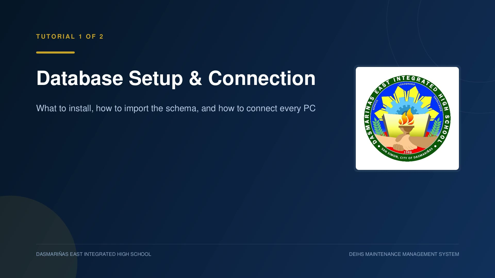
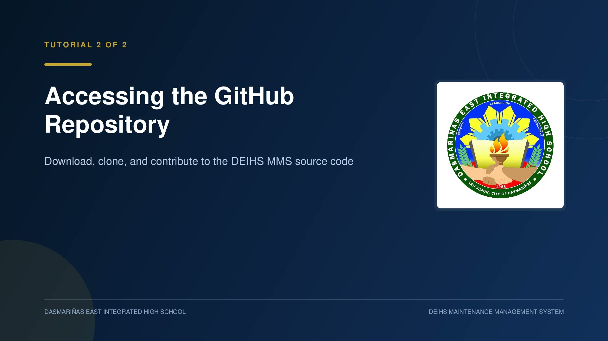

# Video tutorials

Two narrated walkthroughs for members who are setting up the DEIHS Maintenance
Management System for the first time. Both are 1920×1080 MP4 with English
narration, and each has a matching `.srt` caption file.

| # | Video | Length | Covers |
|---|---|---|---|
| 1 | [Database Setup & Connection](01-database-setup.mp4) | 9:14 | Installing XAMPP, importing the schema, connecting the app, LAN sharing |
| 2 | [Accessing the GitHub Repository](02-github-access.mp4) | 7:41 | Downloading, cloning, write access, authentication, pull requests |

Click a link to play or download the file. GitHub does not stream repository
videos inline, so the browser will download it and open it in your media
player. To read the narration instead, open the matching `.srt` file or use the
written steps in the main [`README.md`](../../README.md).

---

## 1. Database Setup & Connection — 9:14

[](01-database-setup.mp4)

**What you need before starting**

- A Windows, macOS, or Linux computer
- JDK 21 (`java -version` reports 21)
- Maven 3.9+ (only to build from source)
- The project folder — see Tutorial 2
- A web browser for phpMyAdmin

**Chapters**

| Time | Topic |
|---|---|
| 0:00 | Introduction and what the tutorial covers |
| 0:23 | The whole setup in five steps |
| 0:52 | What you need before you start |
| 1:18 | Which database to install (MySQL 8 / MariaDB 10.4+, XAMPP recommended) |
| 1:50 | Step 1 — Install XAMPP |
| 2:20 | Step 2 — Start Apache and MySQL |
| 2:47 | Step 3 — Get the project |
| 3:12 | Step 4 — Open phpMyAdmin |
| 3:38 | Step 5 — Import `database/deihs_mms.sql` |
| 4:09 | Step 5 — Verify the import |
| 4:35 | Step 6 — Configure `db.properties` |
| 5:05 | Step 6 — **Check the port** (the most common mistake) |
| 5:37 | Step 7 — Create a dedicated database user |
| 6:02 | Step 8 — Build and run the application |
| 6:30 | Step 8 — Sign in and confirm |
| 6:57 | Step 9 — LAN setup: the server PC |
| 7:28 | Step 9 — LAN setup: the client PCs |
| 7:55 | Troubleshooting the common errors |
| 8:25 | Security checklist before real use |
| 8:50 | Summary |

**The one setting people get wrong**

The committed `src/main/resources/db.properties` now uses `db.port=3306`,
which is what XAMPP listens on. If your MySQL runs on another port (for
example a separate development instance on 3307), put the override in an
untracked `db.local.properties` instead of editing the committed file:

```properties
db.port=3307
```

**Quick fixes**

| Symptom | Cause |
|---|---|
| `Communications link failure` | MySQL stopped, or wrong `db.host` / `db.port` |
| `Access denied for user` | Wrong credentials, or the user cannot connect from this host |
| `Unknown database 'deihs_mms'` | The SQL import did not finish |
| `Port 3306 already in use` | Another MySQL service is running |

---

## 2. Accessing the GitHub Repository — 7:41

[](02-github-access.mp4)

Repository: <https://github.com/mccollybalagtas/DevNexus-DEIHS-MMS>

**What you need before starting**

- A web browser
- A GitHub account (only for pushing changes)
- Git (only if you want to clone and contribute)

**Chapters**

| Time | Topic |
|---|---|
| 0:00 | Introduction |
| 0:24 | What is in the repository |
| 0:47 | Choose your access level (read vs. write) |
| 1:09 | Step 1 — Open the repository on GitHub |
| 1:35 | Step 2 — Option A: download a ZIP |
| 1:59 | Step 3 — Option B: install Git |
| 2:27 | Step 3 — Configure your Git identity |
| 2:51 | Step 4 — Clone the repository |
| 3:15 | Step 4 — Tour of the project folders |
| 3:43 | Step 5 — Read the README and set up |
| 4:04 | Step 6 — Get write access as a collaborator |
| 4:31 | Step 7 — HTTPS authentication with a personal access token |
| 5:00 | Step 7 — SSH authentication (alternative) |
| 5:32 | Step 8 — Daily workflow: pull, branch, commit, push |
| 5:59 | Step 8 — Open a pull request |
| 6:25 | Common errors |
| 6:54 | Repository rules (secrets, force-push, commit messages) |
| 7:21 | Summary |

**Read vs. write access**

- **Read / download** — automatic, because the repository is public.
- **Write / push** — you need an invitation. The owner opens
  *Settings → Collaborators → Add people*, enters your GitHub username, and
  chooses the **Write** role. Accept the invitation from your email or the
  repository page.

**Authentication**

GitHub no longer accepts your account password for Git over HTTPS. Create a
personal access token (fine-grained, limited to this repository,
*Contents: read and write*) and paste it when Git asks for a password. SSH keys
work too; the video shows both paths.

**Quick fixes**

| Symptom | Cause |
|---|---|
| `Repository not found` | Wrong URL, or you are not signed in to a private repo |
| `Authentication failed` | Token missing, wrong, or expired |
| `Permission denied (publickey)` | SSH key not added to GitHub |
| `Push rejected` | Someone pushed first — `git pull`, then push again |
| `Nothing to commit` | Changes were not saved, or already committed |

---

## Captions

Each video ships with an `.srt` file:

- [`01-database-setup.srt`](01-database-setup.srt)
- [`02-github-access.srt`](02-github-access.srt)

VLC, mpv, and most players load a same-named `.srt` automatically. On YouTube or
similar platforms, upload the `.srt` as the subtitle track.

---

## Related reading

| Document | Purpose |
|---|---|
| [`README.md`](../../README.md) | Written setup steps, demo accounts, LAN deployment |
| [`DEIHS_MMS_Build_Guide.html`](../../DEIHS_MMS_Build_Guide.html) | Beginner rebuild guide, part by part |
| [`DEIHS_MMS_Member_Parts.html`](../../DEIHS_MMS_Member_Parts.html) | Per-member ownership and demo scripts |

> Demo accounts are for local testing only. Change every password before the
> system holds real school data.
